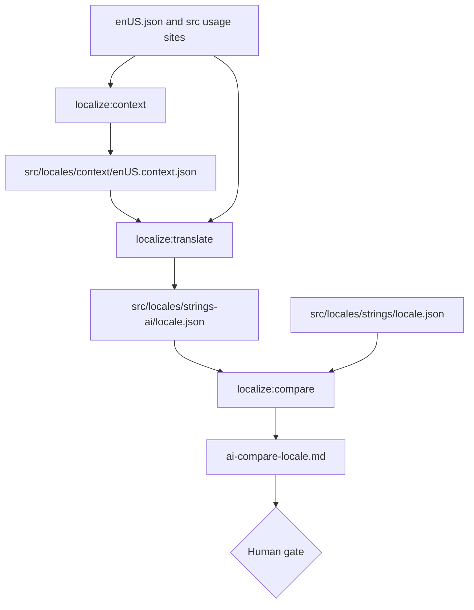

# AI translations: locale files from Claude, checked against the human ones

| | |
|---|---|
| Status | Implemented (subtasks 1 to 3; the switch-over waits on the human gate) |
| Author | Jon Tzeng |
| Reviewer | - |
| Last updated | 2026-10-16 |
| Repos | [EdgeApp/edge-react-gui](https://github.com/EdgeApp/edge-react-gui) |
| Implementation | - |
| Supersedes | - |
| Related | [Asana: Localization - AI Translations, remove Crowdin](https://app.asana.com/0/1215088146871429/1213733788587420) |

<!-- tdd-code-fingerprint: 25556a1d750f1180c8b05b523f26f87bbc89936b -->

File paths are relative to the edge-react-gui root. The spec and its 2026-09-21 amendment ([Jev](#jev) as a classifier and QA layer, less repeated input in the translate step) come from the Asana task and its subtasks.

## Contents

1. [Problem](#1-problem)
2. [Prior art](#2-prior-art)
3. [Goals and non-goals](#3-goals-and-non-goals)
4. [Design overview](#4-design-overview)
5. [Testing](#5-testing)
6. [Phase history](#6-phase-history)
7. [Decisions](#7-decisions)
8. [Glossary](#8-glossary)
9. [References](#9-references)

## 1. Problem

The app ships 12 translated locale files in `src/locales/strings/`, filled by human translators through [Crowdin](#crowdin). enUS has 2,119 keys. Crowdin shows translators a key and an English value with no word on where the string appears or what a placeholder stands for, and the files lag behind enUS: new keys stay empty until someone translates them, and the loader then shows English.

Replacing Crowdin with model translations needs three things the repo does not have: context for every string, a translation script that keeps placeholders intact, and evidence that the output is at least as good as the human files before anything ships.

## 2. Prior art

- **[Crowdin](#crowdin).** `crowdin.yml` maps `src/locales/strings/enUS.json` to one file per locale. `scripts/localizeLanguage.ts` writes enUS.json from `src/locales/en_US.ts`, and `src/locales/strings.ts` merges a locale file over English, skipping empty values. Crowdin's own machine translation sees one string at a time with no app context, which is the gap the context store fills.
- **The existing human files.** They are the baseline the comparison judges against, not a source of truth: the [Jev](#jev) meaning check in [4.3](#43-comparison) flags human values that do not match the English.

## 3. Goals and non-goals

Goals:

- A context entry for every enUS key, regenerated only for keys whose English or usage files changed.
- AI translations for all 12 locales in `src/locales/strings-ai/`, with every [sprintf placeholder](#sprintf-placeholder) and line break kept.
- A per-locale report comparing the AI files with the human files, for a person to decide the switch-over.
- Token use reported per run, Claude and [Jev](#jev) apart.

Non-goals:

- Switching the app to the AI files or removing [Crowdin](#crowdin). That waits on the human decision in subtask 3 and lands in subtasks 4 and 5.
- Translating the store listings Crowdin also handles (`localization/*`).
- Loading kaa in the app: `src/locales/strings.ts` does not import `kaa.json`, and this work does not change that.

## 4. Design overview

Three scripts run in order. Each one reads the output of the one before, and each reruns cheaply because it skips keys whose inputs did not change.



| Script | Writes | Claude model | [Jev](#jev) use |
|---|---|---|---|
| `localize:context` ([4.1](#41-context-store)) | `src/locales/context/enUS.context.json` | sonnet | screens keys for reuse with different meanings |
| `localize:translate` ([4.2](#42-translation)) | `src/locales/strings-ai/*.json`, `src/locales/context/translateState.json` | sonnet | meaning and language check on every value |
| `localize:compare` ([4.3](#43-comparison)) | `ai-compare-<locale>.md` (outside the repo by default) | opus | equivalence score per pair (a judge pre-filter with `--prefilter`), meaning check on the human value |

Shared code lives in `scripts/localize/`: file paths, cleaners and the placeholder check (`common.ts`), the Claude backend (`llm.ts`, [4.4](#44-model-backends-and-token-accounting)), the Jev client (`jev.ts`), the token ledger (`ledger.ts`), usage-site search (`usage.ts`), locale settings (`locales.ts`) and compare helpers (`compare.ts`).

`npm run localize:ai` is the entry point for new or changed strings: it regenerates enUS.json, then runs `localize:context` and `localize:translate --locale all`. Agents follow `.claude/skills/localize-strings/SKILL.md`, which `AGENTS.md` points to: run it after any `en_US.ts` change, commit the generated files with the change, and never hand-translate.

### 4.1 Context store

`scripts/localizeContext.ts` finds every usage site of every key in the `.ts` and `.tsx` files under `src/` (excluding tests; docs and JSON files mention keys without using them), sends Claude batches of 40 keys with up to 3 code snippets each, and writes one entry per key:

[`scripts/localize/common.ts`](https://github.com/EdgeApp/edge-react-gui/blob/5e0e670c336e06fdfa6ac31b77f5809fd257e4f8/scripts/localize/common.ts)
```ts
export const asContextEntry = asObject({
  description: asString,
  uiLocation: asString,
  placeholders: asObject(asString),
  lengthHint: asLengthHint,
  usageFiles: asArray(asString),
  reuseWarning: asOptional(
    asObject({ sites: asArray(asString), reason: asString })
  ),
  unused: asBoolean,
  sourceHash: asString
})
```

- [`sourceHash`](#sourcehash) is the sha256 of the English value plus the sorted usage file list. A rerun keeps every entry whose hash matches and sends only the rest.
- `unused` is true when no file in `src/` references the key. Claude then describes the string from the key name and the English value.
- `lengthHint` is button, label or paragraph, and Claude sets it ([decision 7.2](#72-claude-sets-lengthhint-jev-screens-reuse)).
- `reuseWarning` names the usage sites that need different translations. Jev scores each pair of distinct sites (up to 4 sites, 6 pairs) for shared meaning; a key with any pair under 0.5 goes to Claude as `reuseFlagged`, and Claude keeps the warning only when it agrees the meanings differ.

### 4.2 Translation

`scripts/localizeTranslate.ts --locale <code|all> [--limit N] [--out <dir>]` translates every key whose context `sourceHash` differs from the one recorded for that locale in `translateState.json`.

- **Request shape.** Keys go in batches of 40 in enUS order. For each batch, the English values and context are the system prompt and each locale is a short user prompt sent back to back. Every locale after the first reads the batch from the prompt cache ([decision 7.3](#73-prefix-request-shape)). `--shape baseline` and `--shape multi` keep the two pilot alternatives runnable.
- **Locale settings.** `scripts/localize/locales.ts` gives each locale a language name, an optional Jev language and register instructions (for example Sie for German, Latin script for [Karakalpak](#karakalpak), Mexican vocabulary for esMX).
- **Validation.** Every value must keep the English placeholders and line-break count:

[`scripts/localize/common.ts`](https://github.com/EdgeApp/edge-react-gui/blob/5e0e670c336e06fdfa6ac31b77f5809fd257e4f8/scripts/localize/common.ts)
```ts
export function placeholderProblem(
  english: string,
  translation: string
): string | undefined {
  const expected = sprintfTokens(english).join(' ')
  const actual = sprintfTokens(translation).join(' ')
  if (expected !== actual) {
    return `placeholders [${expected}] became [${actual}]`
  }
  const expectedLines = countNewlines(english)
  const actualLines = countNewlines(translation)
  if (expectedLines !== actualLines) {
    return `${expectedLines} newlines became ${actualLines}`
  }
  return undefined
}
```

- **Jev gate.** Each value that passes the placeholder check goes to Jev with the English and the context description. Jev answers whether the meaning matches (rejected under 0.5) and which language the value is in. The language question is skipped for kaa, which Jev does not list, and for values identical to English; es and esMX both expect Spanish. The gate is report-only by default ([decision 7.4](#74-jev-gate-reports-instead-of-rejecting)): `--gate enforce` treats its rejections like placeholder failures.
- **Retry and failure.** Rejected keys are retried once in batches, with each problem listed in the prompt. A key that fails again is written as an empty string, which the loader shows as English ([decision 7.5](#75-failed-keys-are-written-empty)), and stays out of the state file. The next run retries it.
- **Output.** Each run merges its values into `strings-ai/<locale>.json` in enUS key order, keeping values from earlier runs for keys it did not touch. `--report <file>` writes every first-pass rejection and final failure as JSON.

### 4.3 Comparison

`scripts/localizeCompare.ts --locale it,esMX,es [--out <dir>] [--ai <dir>] [--limit N] [--prefilter]` writes `ai-compare-<locale>.md` per locale and prints a summary table.

1. Keys whose human value is empty or equal to English are skipped: the app shows English for them either way.
2. Each remaining pair goes into a bucket. **Identical** values match exactly; **trivial** ones match after folding case, whitespace, quote and ellipsis styles and trailing punctuation (`normalize` in `scripts/localize/compare.ts`); the rest are **different**.
3. One Jev call per key asks whether the human value keeps the English meaning (under 0.5 lands in the "weak human translations" list) and, for different pairs, whether the two values mean the same. By default every different pair still goes to the judge, and the report's "Pre-filter check" table counts the pairs Jev scored at 0.8, 0.9 and 0.95 or above against the judge's verdicts on them ([decision 7.7](#77-the-jev-pre-filter-is-opt-in)). With `--prefilter`, pairs at 0.9 or above are marked "equivalent (pre-filter)" and skip the judge.
4. Opus judges the different pairs in batches of 40. It sees the two values as A and B, with the order set by the first byte of the key's sha256. Neither side is always first, and a rerun keeps the same order. It answers A, B, equivalent or both wrong with a one-line reason, which the script rewrites to name "existing" and "AI".
5. Placeholder mismatches are checked in both files.

[`scripts/localizeCompare.ts`](https://github.com/EdgeApp/edge-react-gui/blob/5e0e670c336e06fdfa6ac31b77f5809fd257e4f8/scripts/localizeCompare.ts)
```ts
export type Verdict =
  | 'existing better'
  | 'AI better'
  | 'equivalent'
  | 'both wrong'
  | 'equivalent (pre-filter)'
  | 'not judged'
```

The report lists counts, verdicts, the pre-filter check (or, with `--prefilter`, the judge calls it removed), tokens, every "existing better" and "both wrong" pair, a 50-key sample of "AI better" (and of pre-filtered pairs with `--prefilter`), chosen as the first 50 by key hash so the sample is stable across runs, the weak human translations with the judge's verdict on each, and the placeholder mismatches.

### 4.4 Model backends and token accounting

`askClaude` in `scripts/localize/llm.ts` runs `claude -p` on the operator's subscription by default, with tools, MCP (Model Context Protocol) servers and settings files turned off and an empty working directory. Each call carries only the given system prompt. When `ANTHROPIC_API_KEY` is set it calls the Messages API instead, with the system prompt marked for caching. Both paths retry 3 times.

`JevClient` in `scripts/localize/jev.ts` reads `TYPESAFE_API_KEY`. Without it every Jev step is skipped and the scripts fall back to Claude for reuse and to placeholder checks alone for the gate.

Every script ends with a `TokenLedger` summary: Claude calls, input, output, cache write and cache read per model, and Jev calls, input and output on a separate line.

## 5. Testing

Unit tests (`src/__tests__/localizeScripts.test.ts`, `src/__tests__/localizeCompare.test.ts`, 17 cases) cover sprintf token parsing, the placeholder and line-break check, JSON extraction from model replies, batching, the concurrency pool, argument parsing, usage-site dedupe, the compare buckets and normalization, the stable sample, the A/B order and the pre-filter threshold check.

Live runs, all on the subscription:

1. **Context store, full run.** 2,119 of 2,119 keys have an entry. 299 are unused. [Jev](#jev) flagged 32 keys for reuse and Claude confirmed 2 (`fragment_request_subtitle`, `fio_reject_request_title`). lengthHint: label 1,338, paragraph 595, button 186. Claude: 54 calls, output 230,298, cache write 856,096, cache read 27,719. Jev: 3,190 calls, input 1,784,936, output 102,518.
2. **Context store, rerun.** "2119 up to date, 0 new or changed, processing 0": 0 Claude calls, 0 Jev calls.
3. **Context field pilot** (first 100 keys, `--compare`). Jev agreed with Claude on lengthHint for 85% of keys and on reuse for 95%.
4. **Translate shape pilot** (es and it, 100 keys each, one run per shape). Claude output was about 8,000 tokens for every shape. Cache write was 37,349 for baseline, 19,248 for multi and 20,912 plus 16,216 cache read for prefix. 0 placeholder problems in 600 values. The Jev gate rejected 5 values over the three runs and a read of each found all 5 were good translations (for example "Carte regalo" detected as Spanish).
5. **Translate, all 12 locales.** Every file in `src/locales/strings-ai/` has all 2,119 keys in enUS order and 0 empty values. 0 placeholder or line-break failures remain. On the first pass one ja batch and one kaa batch (40 and 41 keys) came back as unparseable JSON, and the retry filled them. The report-only gate flagged between 14 (ko) and 320 (pt) values per locale, mostly language misreads of short labels, loanwords and currency names. A read of all es (50) and it (186) flags found 1 real error: `currency_label_SYP` in it reads "Sterlina siriana" where Italian uses "Lira siriana". Claude: 639 calls, input 1,278, output 841,729, cache write 702,844, cache read 3,335,431. Jev: 25,428 calls, input 10,712,276, output 2,820,027.
6. **Pre-filter pilot** (it and esMX, first 300 keys each, every different pair judged). Of the pairs Jev scored 0.9 or above, the judge called 25 of 50 equivalent in it and 29 of 65 in esMX; most of the rest were "AI better", and 1 per locale was "existing better". At 0.95 agreement was 10 of 13 and 4 of 10. Claude opus: 12 calls, input 24, output 41,924, cache write 86,595. Jev: 600 calls, input 220,976, output 21,996.
7. **Compare, it, esMX and es** (judge opus, every different pair judged).

   | Locale | Different | Existing better | AI better | Equivalent | Both wrong | Weak human (Jev) | Placeholder problems |
   |---|---|---|---|---|---|---|---|
   | it | 1,185 | 60 | 777 | 348 | 0 | 210 | 4 |
   | esMX | 931 | 40 | 592 | 299 | 0 | 102 | 20 |
   | es | 568 | 21 | 317 | 230 | 0 | 68 | 2 |

   Pre-filter check over the same pairs:

   | Threshold | Pairs | Equivalent | AI better | Existing better |
   |---|---|---|---|---|
   | 0.8 | 1,495 | 611 | 829 | 55 |
   | 0.9 | 732 | 336 | 376 | 20 |
   | 0.95 | 149 | 76 | 72 | 1 |

   Every placeholder and line-break mismatch is in the existing human file; the AI files have none. Most "existing better" verdicts share a few causes: the AI used the word for a swap where the text names the exchange provider ("intercambio" for "casa de cambio"), left "[FIO](#fio) Address" or "handle" in English, or translated "birthday height" word for word. Of the weak human values the judge saw, it called 315 "AI better", 29 equivalent and 11 "existing better"; examples of real errors are esMX `request_xlm_minimum_notification_alert_body` (it names XRP, the Ripple coin, in a message about Stellar) and `create_wallet_import_key_instructions` ("semilla privada" for "private key"). Claude opus: 69 calls, input 138, output 260,820, cache write 434,633, cache read 77,148. Jev: 4,526 calls, input 1,616,844, output 156,936.
8. **`npm run localize:ai`, incremental.** The first run found 5 keys changed only because this document names them. Usage search now reads `.ts` and `.tsx` files alone, which moved 6 keys whose extra sites were docs and JSON files (for example `swap`, `select_recv_wallet`). The rerun described those 6 and translated them into all 12 locales with 0 left empty and 2 gate flags. Context: Claude sonnet 1 call, input 2, output 751, cache write 5,740, cache read 589; Jev 36 calls, input 22,314, output 828. Translate: Claude sonnet 12 calls, input 24, output 1,038, cache write 8,456, cache read 13,838; Jev 72 calls, input 28,881, output 5,891.

## 6. Phase history

### 6.1 Subtasks 1 to 3: context, translation, comparison

| Item | Sketched in the spec | Shipped as |
|---|---|---|
| lengthHint | [Jev](#jev) decides when the pilot agrees 90% or more | Claude, after 85% agreement |
| reuseWarning | Jev decides when the pilot agrees 90% or more | Jev screens, Claude confirms the flagged keys (95% pilot agreement, but 30 of 32 full-run flags were false) |
| Request shape | baseline, multi-locale or cached prefix, picked by the pilot | cached prefix |
| Jev QA gate | enforce, retry once, then empty; report-only if more than 1 in 5 rejections are wrong | report-only, after 0 of 5 rejections were correct |
| Compare pre-filter | Jev at 0.9 or above skips the judge | opt-in with `--prefilter`, after the judge called only 45 to 50% of the pairs it would skip equivalent ([7.7](#77-the-jev-pre-filter-is-opt-in)) |

Deferred: switching `src/locales/strings.ts` to the AI files and removing [Crowdin](#crowdin) (subtasks 4 and 5), after the human gate on the compare reports.

## 7. Decisions

### 7.1 Claude through the subscription CLI

- **Chosen:** `claude -p` by default, the Messages API only when `ANTHROPIC_API_KEY` is set.
- **Evidence:** a probe call with tools, MCP and settings off cost about 668 tokens of overhead, and the CLI reports cache write and cache read like the API.
- **Rejected:** API only, because every run would bill an API key the operator would have to approve each time.
- **Reopen when:** runs move to CI, where no subscription login exists.

### 7.2 Claude sets lengthHint, Jev screens reuse

- **Chosen:** lengthHint from Claude; reuse screened by [Jev](#jev) on every key and confirmed by Claude on flagged keys only.
- **Evidence:** the 100-key pilot ([test 3](#5-testing)) gave 85% lengthHint agreement, under the 90% bar the spec set, and 95% reuse agreement. On the full run Jev flagged 32 keys and Claude kept 2.
- **Rejected:** Jev alone for reuse, which would have shipped 30 false warnings; Claude alone for reuse, which needs every key's sites in the prompt even though fewer than 2% of keys are flagged.
- **Reopen when:** a later Jev model passes 90% on the lengthHint pilot.

### 7.3 Prefix request shape

- **Chosen:** each batch is the cached system prompt, with one short request per locale.
- **Evidence:** in the pilot ([test 4](#5-testing)) output was the same for every shape. Prefix and multi each wrote about half the cache baseline did. Prefix values matched baseline wording more often (es 77, it 68 of 100) than multi values (es 74, it 60), and each request still answers in one language.
- **Rejected:** baseline, which writes the full batch once per locale; multi (4 locales per request), whose replies drift further from single-locale wording and put 4 locales at risk when one reply fails to parse.
- **Reopen when:** the cache stops holding across the 12 requests of a batch (cache read near 0 in the run summary).

### 7.4 Jev gate reports instead of rejecting

- **Chosen:** `--gate report` by default; `--gate enforce` stays available.
- **Evidence:** the pilot gate rejected 5 values and none of the 5 was wrong; enforce mode emptied two good Italian values. The spec made the gate report-only when more than about 1 in 5 rejections are wrong.
- **Rejected:** enforce, which would replace good translations with English.
- **Confirmed on the full run:** 1 of the 236 es and it flags was a real error ([test 5](#5-testing)).
- **Reopen when:** a full-run review of the reported rejections finds most of them correct.

### 7.5 Failed keys are written empty

- **Chosen:** a value that fails placeholder validation twice is written as `""` and left out of the state file.
- **Evidence:** `mergeStrings` in `src/locales/strings.ts` skips empty values and shows English instead. The next run retries the key.
- **Rejected:** dropping the key, which loses the enUS key order and the "every key present" check; keeping the bad value, which can crash `sprintf` or show a raw token.
- **Reopen when:** never on its own; the alternative is a human fixing the key.

### 7.6 Blind A/B judging with opus

- **Chosen:** opus judges, sees the pair as A and B in an order set by the key hash, and names A or B in its reason, which the script maps back.
- **Evidence:** the 80-key smoke run on it gave 2 existing better, 26 AI better and 18 equivalent with readable reasons.
- **Rejected:** labeling the values "existing" and "AI", which invites a bias toward either; a random order per run, which makes reruns disagree.
- **Reopen when:** the human gate finds the judge's verdicts unreliable.

### 7.7 The Jev pre-filter is opt-in

- **Chosen:** every different pair goes to the judge by default; `--prefilter` restores the skip at 0.9. Each default run reports how many pairs each threshold would skip and what the judge said about them.
- **Evidence:** over all three locales the judge called 336 of the 732 pairs at 0.9 or above equivalent (46%), 376 "AI better" and 20 "existing better" ([test 7](#5-testing)). Those 20 are 17% of the 121 "existing better" verdicts, the keys the human gate most needs to see. At 0.95 agreement rises to 51% (76 of 149) and the skip saves 4 of 69 judge calls. Judging everything cost 18 more opus calls and 67,911 more output tokens than the pre-filtered run.
- **Rejected:** keeping 0.9, which hides a sixth of the "existing better" keys and undercounts "AI better"; 0.95, which saves too little to matter. Jev's "same meaning" is not the judge's "equally good": two values can mean the same while one reads better.
- **Reopen when:** a different equivalence question to Jev agrees with the judge on 90% or more of the pairs it would skip.

## 8. Glossary

### Crowdin

A hosted translation management service. Here it syncs `src/locales/strings/enUS.json` to human translators and writes the 12 locale files back, configured by `crowdin.yml`. Source: [crowdin.com](https://crowdin.com/).

### FIO

The FIO Protocol, a blockchain of human-readable crypto addresses ("FIO Addresses", also called handles) that the app registers and sends requests through. Its feature names are one of the term groups the AI files sometimes leave in English. Source: [fio.net](https://fio.net/).

### Jev

TypeSafe System One, a decision model that answers yes/no, pick-one and rating questions about a text, in about 250 ms per call. It cannot generate text. Claude does all translation and description; Jev screens reuse, checks meaning and language, and pre-filters compare pairs. Source: [TypeSafe](https://typesafe.ai/), and the client in [`scripts/localize/jev.ts`](https://github.com/EdgeApp/edge-react-gui/blob/5e0e670c336e06fdfa6ac31b77f5809fd257e4f8/scripts/localize/jev.ts).

### Noul

A Jev answer type: the probability, from 0 to 1, that a yes/no statement about the text holds. The scripts compare it with 0.5 (meaning checks, reuse) and 0.9 (compare pre-filter). Source: [`scripts/localize/jev.ts`](https://github.com/EdgeApp/edge-react-gui/blob/5e0e670c336e06fdfa6ac31b77f5809fd257e4f8/scripts/localize/jev.ts).

### Prompt caching

Claude can store a prompt prefix and bill later requests that repeat it as cache reads, at a tenth of the input price. The prefix request shape puts each batch in the system prompt to get this. Source: [Anthropic prompt caching](https://docs.anthropic.com/en/docs/build-with-claude/prompt-caching).

### Sprintf placeholder

A token such as `%s`, `%1$s` or `%d` that `sprintf-js` replaces with a runtime value. A translation must keep the same tokens; positional ones may move. Source: [sprintf.js](https://github.com/alexei/sprintf.js).

### sourceHash

The sha256 recorded in each context entry, over the English value and usage files. `localize:context` skips keys whose hash is unchanged, and `translateState.json` records it per locale. `localize:translate` uses that record to skip them too. Source: [`scripts/localizeContext.ts`](https://github.com/EdgeApp/edge-react-gui/blob/5e0e670c336e06fdfa6ac31b77f5809fd257e4f8/scripts/localizeContext.ts).

### Karakalpak

The kaa locale, a Turkic language of Uzbekistan written here in the 2016 Latin alphabet. Jev does not list it. Its values get the meaning check without the language check. Source: [Karakalpak language](https://en.wikipedia.org/wiki/Karakalpak_language).

## 9. References

- [Asana: Localization - AI Translations, remove Crowdin](https://app.asana.com/0/1215088146871429/1213733788587420)
- [Anthropic prompt caching](https://docs.anthropic.com/en/docs/build-with-claude/prompt-caching)
- [Claude Code CLI reference](https://docs.anthropic.com/en/docs/claude-code/cli-reference)
- [sprintf.js](https://github.com/alexei/sprintf.js)
- [cleaners](https://github.com/EdgeApp/cleaners)
