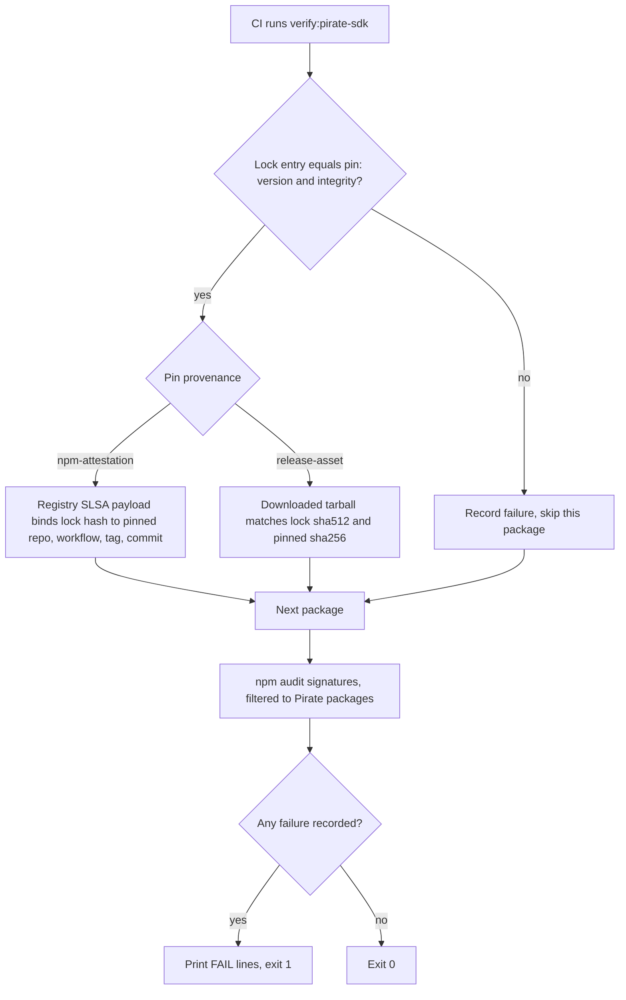

# Pirate SDK provenance gate: CI check that binds the ARRR native packages to a pinned upstream build

| | |
|---|---|
| Status | Implemented |
| Author | Jon Tzeng |
| Reviewer | - |
| Last updated | 2026-10-24 |
| Repos | [edge-react-gui](https://github.com/EdgeApp/edge-react-gui) |
| Implementation | see the PR link in the [Asana task](https://app.asana.com/0/1215088146871429/1216926437132721) |
| Supersedes | - |
| Related | [edge-react-gui#6021](https://github.com/EdgeApp/edge-react-gui/pull/6021), [review thread](https://github.com/EdgeApp/edge-react-gui/pull/6021#discussion_r4067816223) |

<!-- tdd-code-fingerprint: 7d3210a13ef345d713b7e71f70ae45e24b7e6a1e -->

Code references point at `edge-react-gui` branch `jon/pirate-sdk-provenance-gate`. Direction came from an automated security review thread on the Piratechain SDK upgrade PR, which was merged without an answer.

## Contents

1. [Problem](#1-problem)
2. [Prior art](#2-prior-art)
3. [Goals and non-goals](#3-goals-and-non-goals)
4. [Design overview](#4-design-overview)
   1. [Pins file](#41-pins-file)
   2. [Checks](#42-checks)
5. [Testing](#5-testing)
6. [Phase history](#6-phase-history)
7. [Decisions](#7-decisions)
   1. [Pins file and gate script](#71-pins-file-and-gate-script)
   2. [Hash pin for the package without provenance](#72-hash-pin-for-the-package-without-provenance)
   3. [Registry payload plus npm audit](#73-registry-payload-plus-npm-audit)
   4. [Travis step](#74-travis-step)
8. [Glossary](#8-glossary)
9. [References](#9-references)

## 1. Problem

The ARRR (Pirate Chain) wallet runs native spend code that ships as npm packages named `react-native-pirate-wallet*`. The packages carry prebuilt [JNI](#jni) libraries for Android and [xcframeworks](#xcframework) for iOS. Both load into the app process, next to the keys of every wallet.

The review thread on [edge-react-gui#6021](https://github.com/EdgeApp/edge-react-gui/pull/6021#discussion_r4067816223) (severity MEDIUM, written against version 0.3.4) states the gap: Edge CI checks only that `package-lock.json` matches what was installed. The lockfile [integrity hash](#integrity-hash) proves the bytes did not change since someone ran `npm install`. It says nothing about who built them or from what source. A substituted `libpirate_ffi_native.so` that was installed once and locked would pass every existing check.

On `develop` the packages are at 0.3.9. Checking the registry for each of the seven packages showed:

| Package | Role | [npm provenance](#npm-provenance) |
|---|---|---|
| `react-native-pirate-wallet` | JS wrapper | yes |
| `react-native-pirate-wallet-android` | Android binaries | yes |
| `react-native-pirate-wallet-android-external` | Android binaries the app builds use (`pirateWalletAndroidBinaryPackage` in `android/gradle.properties`) | **no** |
| `react-native-pirate-wallet-android-x86_64` | Android x86_64 binaries | yes |
| `react-native-pirate-wallet-ios-device` | iOS device [xcframework](#xcframework) | yes |
| `react-native-pirate-wallet-ios-simulator-arm64` | iOS simulator xcframework | yes |
| `react-native-pirate-wallet-ios-simulator-x86_64` | iOS simulator xcframework | yes |

The six attested packages were built by the `.github/workflows/ci.yml` workflow of `PirateNetwork/Stashi-Wallet` at tag `v1.2.6`, commit `dedf63381996c5770945d16a4afa63ec7e35a676`. Their attestation subjects match the lockfile hashes. The package that Android builds actually link has no attestation. A provenance-only check would skip the highest-risk file.

## 2. Prior art

- `npm audit signatures` verifies registry signatures and [npm provenance](#npm-provenance) for installed packages. On the installed tree it verified 869 registry signatures and 42 attestations with `{"invalid":[],"missing":[]}`. It reports no finding for a package that publishes no attestation, which leaves `-android-external` unchecked. It also cannot see the iOS packages on a Linux CI machine because they are optional, darwin-only dependencies.
- Lockfile integrity (`npm ci`) detects change after locking, nothing about origin.
- The upstream release publishes `pirate-unified-wallet-react-native-plugin-artifacts-v1.2.6.zip`, a bundle containing the same tarballs. Its sha256 is listed in the release's `sha256sum-v1.2.6.txt`, which has a [PGP](#pgp) signature (`.sig` plus `public_key.asc`). The `-android-external` tarball from npm has the same bytes (sha256 `1e41ef188ae463d20b0ef86855884b0bce5e176ede6fd687010210cb8ec434ff`) as the copy inside that zip. The signature on `sha256sum-v1.2.6.txt` was checked with Node's `crypto` module: it is a v4 [RSA](#rsa) signature over [SHA](#sha)-512 from the key with fingerprint `E4FB 2399 AECC F9B9 447D ED47 2CE6 5343 4015 53A6`, and it verifies. The same fingerprint is published in the upstream repository's `release-signing/README` and `docs/verify-build.md`, and the `public_key.asc` in the release has the same sha256 as the one committed at tag `v1.2.6`. Both sources belong to the same upstream project as the release, which shows consistency and gives no independent trust anchor. A copy with one digit of the zip's hash changed fails verification.

## 3. Goals and non-goals

Goals:

- A lockfile change to any Pirate package fails CI until a human edits a pins file in the same PR.
- Every pinned package is tied to a known upstream build: by attestation where one exists, by a pinned file hash where it does not.
- The check runs in the existing CI pipeline with no new dependency.

Non-goals:

- Proving the upstream source is free of malicious code. Provenance says where the bytes were built, not what the code does.
- Verifying the [PGP](#pgp) signature inside the script. It was verified once by hand when the pin was taken ([2](#2-prior-art)), and the update procedure in the script header repeats the check for each new release. The gate has no OpenPGP implementation, and CI has no `gpg`.
- Verifying the [Sigstore](#sigstore) certificate chain inside the script ([7.3](#73-registry-payload-plus-npm-audit)).
- Gating transitive dependencies other than the seven Pirate packages.

## 4. Design overview

One TypeScript script and one JSON file, both under `scripts/`, run by `npm run verify:pirate-sdk` as a step in `.travis.yml` after the existing lint, type check, and test steps. Each pinned package is checked by exactly one method, then `npm audit signatures` runs once. Failures accumulate and print together; the script exits 1 if any were recorded.



### 4.1 Pins file

`scripts/pirateSdkPins.json` records one upstream release and one entry per package:

| Field | Meaning |
|---|---|
| `repository`, `workflow`, `tag`, `commit` | The upstream build every attested package must come from |
| `packages.<name>.version`, `integrity` | What the lockfile must contain, copied from `package-lock.json` |
| `packages.<name>.provenance` | `npm-attestation` or `release-asset`, the method used for this package |
| `packages.<name>.sha256` | For `release-asset` only: the tarball hash, taken from the same file inside the release zip |

The shape is enforced by a cleaner:

[`scripts/verifyPirateSdk.ts`](https://github.com/EdgeApp/edge-react-gui/blob/15a059631e048fd462b0d91ce21809c28831903f/scripts/verifyPirateSdk.ts)
```ts
const asPin = asObject({
  version: asString,
  integrity: asString,
  provenance: asEither(asValue('npm-attestation'), asValue('release-asset')),
  sha256: asMaybe(asString)
})
```

Approving a new upstream release is a PR that edits this file. The header comment of the script lists the steps: read `tag` and `commit` from the new version's provenance; for a `release-asset` package, download the tarball from the release zip, confirm the zip is listed in the release's signed `sha256sum` file, and pin the tarball sha256.

### 4.2 Checks

For each `node_modules/react-native-pirate-wallet*` entry in `package-lock.json`:

1. A pin must exist, and the lock version and integrity must equal it. A pin with no lock entry also fails. Removed packages cannot leave stale approvals behind.
2. `npm-attestation` packages: the script fetches `https://registry.npmjs.org/-/npm/v1/attestations/<name>@<version>`, takes the [SLSA](#slsa) provenance statement, and requires that its subject `pkg:npm/<name>@<version>` carries the lockfile sha512, and that the workflow repository, path, ref (`refs/tags/<tag>`) and resolved git commit equal the pins.
3. `release-asset` packages: the script downloads the lockfile's `resolved` tarball and requires that its sha512 equals the lockfile integrity and its sha256 equals the pin:

[`scripts/verifyPirateSdk.ts`](https://github.com/EdgeApp/edge-react-gui/blob/15a059631e048fd462b0d91ce21809c28831903f/scripts/verifyPirateSdk.ts)
```ts
  const problems: string[] = []
  const sha512 = `sha512-${createHash('sha512').update(bytes).digest('base64')}`
  if (sha512 !== pin.integrity) {
    problems.push('downloaded tarball does not match the lockfile hash')
  }
  const sha256 = createHash('sha256').update(bytes).digest('hex')
  if (sha256 !== pin.sha256) {
    problems.push(`tarball sha256 is ${sha256}, pin has ${pin.sha256}`)
  }
  return problems
```

4. `npm audit signatures --json` runs once. Its non-zero exit (npm uses it for invalid signatures) is tolerated, and the JSON on stdout is still read. Only entries whose names are Pirate packages are kept.

Optional platform packages that npm does not install on the CI machine are absent from step 4, but steps 1 and 2 still bind them to the lockfile.

## 5. Testing

1. Live pass: `npm run verify:pirate-sdk` on `develop`'s lockfile prints `ok <name>@0.3.9` for all seven packages and exits 0 (about 52 seconds, mostly the audit and the 59 MB download).
2. Tampered `integrity` pin for `react-native-pirate-wallet`: prints `lockfile has ... pin has ...`, exits 1.
3. Tampered `sha256` pin for `-android-external`: prints `tarball sha256 is 1e41ef18..., pin has 000...`, exits 1.
4. Tampered `commit`: all six attested packages print `built from a commit other than 000...`, exit 1.
5. Pin for `-ios-device` removed and a pin for a nonexistent package added: prints `not listed in pirateSdkPins.json` and `pinned but missing from package-lock.json`.
6. `tsc`, eslint on the changed files, and the full jest suite pass (`verify-repo.sh`).

7. [PGP](#pgp) signature of `sha256sum-v1.2.6.txt` verified with a short Node script using only `crypto` (fingerprint `E4FB2399AECCF9B9447DED472CE65343401553A6`, `GOOD`). The same script reports `BAD` on a copy with one digit of the zip's hash changed.

Not exercised: the branch where `npm audit signatures` itself reports an invalid signature, and the first run on Travis. The audit parsing was run only against a clean result; the non-zero-exit path is read from the code.

## 6. Phase history

### Phase 1: SDK upgrade

| | |
|---|---|
| Sketched | Move ARRR to the PirateNetwork npm companions (`react-native-pirate-wallet` plus platform tarballs) |
| Shipped | [edge-react-gui#6021](https://github.com/EdgeApp/edge-react-gui/pull/6021), merged 2026-09-22 at 0.3.4, lockfile integrity as the only supply-chain check |
| Divergence | A MEDIUM review thread on `package.json` stayed unanswered at merge |

### Phase 2: provenance gate

| | |
|---|---|
| Sketched | A script that checks the registry attestation for every Pirate package |
| Shipped | Attestation check for six packages plus a release-asset hash pin for `-android-external`, which has no attestation, plus `npm audit signatures` |
| Divergence | The attestation-only sketch would have skipped the Android binaries, found during investigation ([1](#1-problem)); the release-asset method was added ([7.2](#72-hash-pin-for-the-package-without-provenance)) |

## 7. Decisions

### 7.1 Pins file and gate script

- **Chosen:** a checked-in pins file plus a script that compares the lockfile to it.
- **Evidence:** `npm audit signatures` reports clean on the current tree while `-android-external` has no attestation ([2](#2-prior-art)). The built-in check alone leaves the highest-risk file ungated. A pins file makes every version bump a reviewable diff.
- **Rejected:** relying on `npm audit signatures` alone (silent on unattested packages, blind to the optional iOS packages on Linux); a lockfile-only rule such as "no Pirate lock change without a label" (no technical binding to the upstream build).
- **Reopen when:** upstream attests all seven packages and `npm audit signatures` can enforce attestation presence.

### 7.2 Hash pin for the package without provenance

- **Chosen:** pin the sha256 of the `-android-external` tarball, taken from the same file inside the upstream release zip.
- **Evidence:** the npm tarball and the zip entry have the same bytes, and the zip's hash is in the release's signed `sha256sum` file. The seven packages unpack to about 752 MB, mostly binaries.
- **Rejected:** vendoring the binaries into the repo (hundreds of MB of binaries per upgrade, and the repo stops using the registry's own signature checks); rebuilding the native libraries in Edge CI (needs the upstream native toolchain and gives no reproducibility guarantee that the result matches what upstream ships).
- **Reopen when:** upstream publishes `-android-external` with provenance, at which point its pin switches to `npm-attestation`.

### 7.3 Registry payload plus npm audit

- **Chosen:** read the [SLSA](#slsa) statement from the registry attestations endpoint to compare fields, and leave the cryptographic verification of the [Sigstore](#sigstore) bundle to `npm audit signatures`.
- **Evidence:** `npm audit signatures` already verifies the certificate chain for installed packages. The script only needs to bind the verified subject to the pinned build. A bundle verifier in the script would be a second implementation of the same check.
- **Rejected:** adding the `sigstore` package to verify bundles in the script (a new dependency in the install path of a check that exists to limit supply-chain risk).
- **Reopen when:** the iOS packages need to be verified on Linux CI, which `npm audit signatures` cannot do for uninstalled optional packages.

### 7.4 Travis step

- **Chosen:** add `npm run verify:pirate-sdk` to the `script:` list in `.travis.yml`.
- **Evidence:** `.travis.yml` is where `npm ci` installs the locked tree and where lint, `tsc`, and jest run. `.github/workflows/pr-checks.yml` only blocks work-in-progress PRs and installs nothing.
- **Rejected:** a separate GitHub Actions workflow (a second install of the dependency tree to run a seven-package check).
- **Reopen when:** CI moves off Travis.

## 8. Glossary

### Integrity hash

The `integrity` field in `package-lock.json`, a sha512 digest of a package tarball. In this design it is the value that every other check is tied to. Source: [npm package-lock.json documentation](https://docs.npmjs.com/cli/v10/configuring-npm/package-lock-json).

### JNI

Java Native Interface. The mechanism by which Android app code loads and calls native `.so` libraries. Here, `libpirate_ffi_native.so` is a JNI library that runs in the app process and handles wallet keys. Source: [JNI specification](https://docs.oracle.com/en/java/javase/17/docs/specs/jni/index.html).

### npm provenance

A signed statement published with an npm package that names the repository, workflow, and commit that built it. The gate reads the statement for six of the seven packages. Source: [npm documentation, generating provenance statements](https://docs.npmjs.com/generating-provenance-statements).

### PGP

Pretty Good Privacy, a public-key signature format. The upstream release signs its `sha256sum` file with it. The gate does not check this signature; the person approving a new version does, using the fingerprint recorded in the script header. Source: [RFC 4880, OpenPGP Message Format](https://www.rfc-editor.org/rfc/rfc4880).

### RSA

Rivest-Shamir-Adleman, a public-key algorithm. The upstream release key is an RSA key, and the checksum file's signature is verified against its public half. Source: [RFC 8017, PKCS #1](https://www.rfc-editor.org/rfc/rfc8017).

### SHA

Secure Hash Algorithm. The pins use SHA-512 (the lockfile `integrity` field) and SHA-256 (the release checksum file and the `-android-external` pin); the upstream signature is made over a SHA-512 digest. Source: [FIPS 180-4, Secure Hash Standard](https://csrc.nist.gov/pubs/fips/180-4/upd1/final).

### Sigstore

A public signing and verification service whose certificates back npm provenance. `npm audit signatures` verifies the Sigstore bundle; the gate script does not. Source: [Sigstore documentation](https://docs.sigstore.dev/).

### SLSA

Supply-chain Levels for Software Artifacts. The provenance statement format (`https://slsa.dev/provenance/v1`) that carries the subject digest, workflow, and commit the gate compares against its pins. Source: [SLSA provenance specification](https://slsa.dev/spec/v1.0/provenance).

### xcframework

A bundle of prebuilt iOS libraries for several architectures. `PirateWalletNative.xcframework` is the iOS counterpart of the JNI library. Source: [Apple documentation, creating a multi-platform binary framework bundle](https://developer.apple.com/documentation/xcode/creating-a-multi-platform-binary-framework-bundle).

## 9. References

- Review thread: [edge-react-gui#6021 discussion](https://github.com/EdgeApp/edge-react-gui/pull/6021#discussion_r4067816223)
- Upstream release: [PirateNetwork/Stashi-Wallet v1.2.6](https://github.com/PirateNetwork/Stashi-Wallet/releases/tag/v1.2.6)
- Task: [Asana](https://app.asana.com/0/1215088146871429/1216926437132721)
